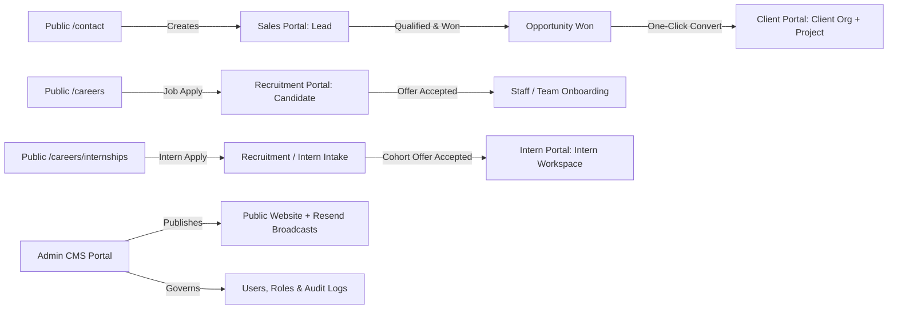

# 10 — FIVE-PORTAL PRODUCT REQUIREMENTS SPECIFICATION

**Date:** 2026-11-27  
**Scope Mandate:** **ALL FIVE PORTALS** (`Admin CMS`, `Client`, `Intern`, `Recruitment`, `Sales Team`) are included in the **initial product architecture**.

---

## 1. Purpose & Scope

Defines complete functional requirements, user roles, state machines, core workflows, cross-portal data handoffs, and boundaries for all five operational portals sharing Tech Groww's unified PostgreSQL + Next.js platform.

**Dependencies:** `PROJECT_OVERVIEW.md` (Doc 01), `WEBSITE_SITEMAP.md` (Doc 07), `11_RBAC_AND_AUTHORIZATION_MATRIX.md`, `12_DATABASE_ARCHITECTURE_AND_ERD.md`.

---

## 2. Cross-Portal Lifecycle Architecture

---

## 3. Portal 1 — Admin CMS Portal (`/admin`)

### 3.1 Roles Covered
- **Primary `/admin` Roles:** `super_admin`, `admin`, `content_manager`, `editor`, `operations_manager` (read-only CMS/ops context + `/client` delivery admin), `auditor` (read-only settings + `audit_logs`).
- *(Note: Domain specialists in Sales [`sales_admin`, `sales_manager`] and HR [`recruitment_admin`] operate inside `/sales` and `/recruitment` respectively and do NOT hold `/admin` route access unless explicitly assigned a multi-role CMS/Admin role in `user_roles` per `11_RBAC_AND_AUTHORIZATION_MATRIX.md`.)*

### 3.2 Required Modules & Workflows
1. **Executive Dashboard (`/admin`):** Real-time DB queries only (new inquiries count, active leads, published posts, open jobs, recent applications, pending draft reviews, system/integration health indicators).
2. **Page & Section Management (`/admin/pages`):** Create/edit/archive custom pages, reorder modular sections (`hero`, `rich_text`, `pillars`, `faq`, `cta`), save drafts, generate signed draft preview URL, publish/unpublish with ISR cache revalidation.
3. **Services Management (`/admin/services`):** CRUD for services, categories, capabilities list, technology tags, FAQs, cover asset, SEO metadata, and `draft`/`published` toggle (controls AI/Automation visibility safely).
4. **Navigation Management (`/admin/navigation`):** Manage header & footer menus (`label`, `href`, `order`, `group`, `is_external`).
5. **Portfolio / Work Management (`/admin/work`):** CRUD for projects with mandatory `project_type` (`client_project`, `internal_product`, `reference_blueprint`), client approval flag (`is_client_approved`), screenshots, tech stack, challenge/architecture, and featured order.
6. **Blog & Insights Management (`/admin/insights`):** Rich-text/Markdown editor, cover image + mandatory alt text, categories, tags, author attribution, `draft` -> `in_review` -> `scheduled` -> `published` workflow, related posts, SEO overrides.
7. **Team & Testimonials (`/admin/team`, `/admin/testimonials`):** Team profiles with `is_public` toggle; Testimonials with mandatory `approval_proof_note` and `is_approved` gate before public visibility.
8. **Media Library (`/admin/media`):** Direct upload to private/public storage bucket, folder/tag organization, mandatory `alt_text`, MIME/size metadata, usage check before delete.
9. **SEO & Redirects (`/admin/seo`):** Page-level meta title/description/OG/canonical, `noindex` overrides, dynamic `sitemap.xml` preview, `301`/`302` redirect rules table.
10. **Resend Broadcasts & Notifications (`/admin/broadcasts`):** Sync/view newsletter subscribers, compose broadcast campaigns, send self-test preview (`POST /api/v1/admin/broadcasts/test`, allowed for `content_manager` on drafts), trigger live Resend Broadcast API (`POST /api/v1/admin/broadcasts/send`, restricted to `admin`/`super_admin`) with mandatory RFC 8058 unsubscribe link enforcement.
11. **Global Settings (`/admin/settings`):** Company info, phone, emails, social URLs, announcement bar toggle, cookie/GA4 ID (loaded only on consent).
12. **User, Role & Audit Management (`/admin/users`, `/admin/audit`):** Invite staff (`@techgroww.co.in`), assign/revoke roles, suspend accounts, inspect immutable `audit_logs` (who changed what, before/after diff, IP, timestamp).

### 3.3 Editorial Approval Workflow
`draft` -> `in_review` (Editor submits) -> `published` (Content Manager / Admin approves) -> `archived`.

---

## 4. Portal 2 — Client Portal (`/client`)

### 4.1 Roles Covered
- `client_admin` (organization owner: can invite/remove own org viewers, approve deliverables, open tickets), `client_member` (collaborate, comment, upload files, create tickets), `client_viewer` (read-only milestones & deliverables).

### 4.2 Required Modules & Workflows
1. **Invite-Only Onboarding:** Client invited via tokenized link created from won project -> sets password or signs in -> scoped strictly to `client_org_id` via PostgreSQL RLS.
2. **Project Overview & Milestones (`/client`, `/client/projects/[id]`):** View active projects, phase timeline (`Discovery`, `Architecture`, `Development`, `QA`, `Launch`), milestone progress, target dates, and status (`not_started`, `in_progress`, `in_review`, `approved`). *(Managed internally by `operations_manager`, assigned via `client_projects.operations_manager_id`.)*
3. **Deliverables & Sign-Off:** Review staged deliverable summaries/links, submit `Approve` or `Request Revision` feedback logged with timestamp & user ID (alerts assigned `operations_manager`).
4. **Shared File Vault (`/client/files`):** Upload/download project briefs, architecture docs, and contracts via short-lived signed storage URLs (`60s`–`300s` expiry).
5. **Project Communication & Support Tickets (`/client/messages`, `/client/tickets`):** Structured thread per project + dedicated support tickets (`low`, `medium`, `high`, `urgent`) with status transitions (`open`, `in_progress`, `waiting_on_client`, `resolved`, `closed`).
6. **Billing Records (`/client/billing`):** *Explicit Distinction:* Displays read-only invoice/milestone billing records and downloadable PDF statements uploaded by Tech Groww Operations. **Online payment gateway processing (Razorpay/Stripe) is NOT implemented in MVP** and is flagged as an explicit future integration hook.
7. **Account & Team Settings (`/client/settings`):** Notification preferences + org member directory (`client_admin` only).

---

## 5. Portal 3 — Intern Portal (`/intern`)

### 5.1 Roles Covered
- `intern`, `mentor`, `internship_coordinator`, `internship_admin`.

### 5.2 Required Modules & Workflows
1. **Cohort & Onboarding (`/intern`, `/intern/onboarding`):** Enrolled interns complete checklist (profile info, code of conduct, NDA/policy acknowledgement, tool setup) tied to an `internship_programs` cohort (e.g., *2-Month Sales Internship*). *Source-of-Truth Rule:* `job_postings` (`posting_kind = 'internship'`, optionally linked via `target_program_id`) drives public `/careers/internships` listings and applications, while `internship_programs` manages active enrolled cohorts, mentors, tasks, and certificates.
2. **Assignments & Task Board (`/intern/tasks`):** View mentor-assigned tasks (`todo`, `in_progress`, `submitted`, `revision_requested`, `completed`) with due dates and priority.
3. **Submission & Mentor Review (`/intern/submissions`):** Submit deliverable links or file attachments -> Mentor posts structured review feedback & rubric score.
4. **Data Privacy & Evaluation Isolation:** Interns can see **only their own** submissions, mentor evaluations, attendance, and certificate. **Cohort Announcements** (`/intern/announcements`, table `cohort_announcements`) are visible cohort-wide; peer evaluation scores are strictly invisible to other interns.
5. **Attendance (`/intern/attendance`):** Daily attendance log (`present`, `excused`, `absent`) recorded by `mentor`/`internship_coordinator`/`internship_admin` with optional intern self check-in (`C(Own)`, `R(Own)`) when enabled — **gated behind `internship_programs.attendance_enabled` feature flag** pending `[COMPANY CONFIRMATION REQUIRED: Formal internship attendance tracking policy — C-09]`.
6. **Completion Certificates (`/intern/certificates`):** Issued only by `internship_admin`/`internship_coordinator` after completion criteria met; generates unique `certificate_code` and downloadable PDF record.

---

## 6. Portal 4 — Recruitment Portal (`/recruitment`)

### 6.1 Roles Covered
- `candidate` (tokenized `/careers/status` lookup link for status view, interview schedule, withdrawal & offer acceptance/decline), `recruiter`, `hiring_manager`, `recruitment_admin`.

### 6.2 Required Modules & Workflows
1. **Job & Internship Requisitions (`/recruitment/jobs`):** Create, edit, publish/close openings synced live to `/careers` and `/careers/internships`.
2. **Public Application Intake:** Captures candidate details + resume upload (`PDF`/`DOCX`, max 5 MB, private bucket, MIME magic-byte verified) -> sends automated Resend acknowledgement email.
3. **Candidate Pipeline (`/recruitment/candidates`):** Stage transitions (`applied` -> `screening` -> `interview` -> `offer` -> `hired` | `rejected` | `withdrawn`).
4. **Interview Scheduling & Scorecards (`/recruitment/applications/[id]`):** Schedule interview slots (with optional Google Calendar link), record structured interviewer feedback and private `recruitment_notes` (invisible to candidates and non-HR staff).
5. **Offer Management (`/recruitment/offers`):** Track offer letter issue date, compensation/stipend note (restricted to `recruitment_admin` / `hiring_manager`), acceptance status, and one-click conversion into Intern Cohort or Staff onboarding.
6. **DPDP Retention & Deletion (`/recruitment/retention`):** Automated retention marker (e.g., purge rejected candidate PII/resumes after `180 days` unless consent to talent pool) + one-click right-to-erasure anonymization.

---

## 7. Portal 5 — Sales Team Portal (`/sales`)

### 7.1 Roles Covered
- `sales_rep`, `sales_manager`, `sales_admin`.

### 7.2 Required Modules & Workflows
1. **Inbound Lead Inbox (`/sales/leads`):** Every `/contact` submission creates a `contact_enquiry` and linked `lead` record (`new`), triggers Resend alert to `sales@techgroww.co.in`, and optionally appends a row to Google Sheets.
2. **Ownership & Assignment:** `sales_manager`/`sales_admin` assigns leads to a `sales_rep`. **Isolation Rule:** `sales_rep` views only assigned leads/opportunities (plus unassigned queue if enabled by policy) and **cannot** access HR resumes, admin settings, audit logs, or unrestricted company financials.
3. **Qualification & CRM (`/sales/contacts`, `/sales/organizations`):** Convert raw enquiry into structured Contact + Organization + Opportunity.
4. **Opportunity Pipeline (`/sales/opportunities`):** Kanban & table stages (`discovery` -> `scoping` -> `proposal_sent` -> `negotiation` -> `won` | `lost` with mandatory `lost_reason`).
5. **Follow-Ups & Activity Timeline (`/sales/activities`):** Log calls, WhatsApp touches, emails, meetings, and scheduled next-action reminders.
6. **Proposals & Handoff (`/sales/proposals`):** Attach proposal documents, record estimated deal value (INR/USD), and trigger **"Convert Won Deal -> Client Portal Project"** workflow creating the `client` org & initial project shell.
7. **Sales Reporting (`/sales/reports`):** Real DB conversion funnel, source breakdown, and rep activity metrics (`sales_rep` sees own metrics; `sales_manager` sees team metrics).

---

## 8. Acceptance Criteria & Cross-References

- Every portal has explicit roles, page routes, state transitions, privacy rules, and cross-portal handoffs.
- Zero reliance on static/mocked dashboard numbers in production architecture.
- **Cross-References:** `11_RBAC_AND_AUTHORIZATION_MATRIX.md`, `12_DATABASE_ARCHITECTURE_AND_ERD.md`, `13_API_AND_INTEGRATION_CONTRACTS.md`.
