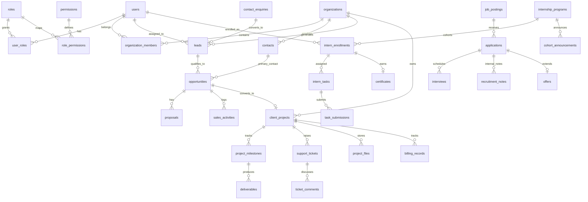

# 12 — DATABASE ARCHITECTURE & RELATIONAL SCHEMA BLUEPRINT

**Date:** 2026-11-27  
**Engine:** PostgreSQL 15+ (Managed via **Supabase** — `14_TECH_STACK_AND_HOSTING_DECISION.md`)  
**Scope:** Canonical normalized schema supporting Public CMS + **all 5 Initial-Scope Portals** (`Admin CMS`, `Client`, `Intern`, `Recruitment`, `Sales Team`) with PostgreSQL Row-Level Security (RLS).

*(Note: This is an architectural blueprint only. Executable SQL migrations are deferred to the implementation phase.)*

---

## 1. Purpose, Scope & Deduplication Decisions

Evaluating the raw entity list from the brief revealed overlapping concepts (`clients` vs `organizations`, `projects` [portfolio] vs `projects` [client delivery], `contact_enquiries` vs `leads`, `internship_applications` vs `job_applications`, `seo_metadata` across tables). To eliminate duplication while keeping queries fast and clean:

1. **Canonical `organizations` table** with `org_type` (`'client' | 'prospect' | 'partner'`) replaces redundant `clients` + `sales_organizations` tables.
2. **Portfolio Showcase (`portfolio_items`) vs Client Delivery (`client_projects`)**: Separate tables! Public portfolio/Reference Blueprints (`portfolio_items`) have public read RLS and `project_type` enums; confidential client delivery projects (`client_projects`) have strict org-tenant RLS and zero public access.
3. **Unified `applications` vs Split Intake**: Use **`job_postings`** (`posting_kind`: `'job' | 'internship'`) and **`applications`** (`application_kind`: `'job' | 'internship'`) so public application flows, resume storage, interview scheduling, and DPDP deletion share one hardened pipeline, branching cleanly into `offers` -> `intern_enrollments` or staff onboarding!
4. **Enquiries -> Leads Link:** `contact_enquiries` stores the immutable raw inbound form payload (`source`, `ip_hash`, `turnstile_verified`); creating a `contact_enquiry` transactionally creates or links a `leads` CRM record (`enquiry_id` FK) so raw submission history is never overwritten by sales edits.
5. **Embedded JSONB SEO vs Separate Table:** Store `seo_title`, `seo_description`, `canonical_url`, `og_image_asset_id`, `noindex` cleanly as structured columns (or typed JSONB `seo`) directly on `pages`, `services`, `portfolio_items`, `blog_posts`, and `job_postings`, plus a dedicated `redirects` table.

---

## 2. Entity-Relationship Diagram (Mermaid)

---

## 3. Canonical Entity Specifications (Grouped by Domain)

### 3.1 Identity, Access & Multi-Tenancy
| Table | PK & Key Columns | FKs / Constraints / Indexes | Access Boundary & Retention |
|---|---|---|---|
| `users` | `id` (uuid PK, matches `auth.users.id`), `email` (citext NOT NULL), `full_name`, `avatar_asset_id` (nullable FK to `media_assets` in `002`), `account_class` (`staff|client|intern|candidate`), `status` (`invited|active|suspended`), `mfa_enabled` bool, `session_version` int DEFAULT 1, `notification_preferences` jsonb DEFAULT `'{}'`, `last_login_at`, `created_at`, `deleted_at` | Index `(account_class, status)`, **partial unique ONLY** `CREATE UNIQUE INDEX uq_users_active_email ON users (email) WHERE deleted_at IS NULL` | Self read/update profile & notification prefs; `super_admin`/`admin` manage. Allows re-inviting soft-deleted addresses cleanly. |
| `roles` | `id` (uuid PK), `slug` (varchar UNIQUE, e.g. `sales_rep`), `label`, `portal_scope`, `is_system` | Unique `(slug)` | Staff read; `super_admin` manage (20 canonical roles seeded). |
| `permissions` | `id` (uuid PK), `resource` (varchar), `action` (varchar), `description` | Unique `(resource, action)` | Seeded system catalog. |
| `role_permissions` | `role_id`, `permission_id` | Composite PK `(role_id, permission_id)` | System RBAC mapping. |
| `user_roles` | `id` (uuid PK), `user_id` (FK `users`), `role_id` (FK `roles`), `granted_by` (FK `users`), `created_at` | Unique `(user_id, role_id)`, Index `(user_id)` | Internal staff & intern role lookup (`organization_members.org_role` governs external client permissions); audited on grant/revoke. |
| `organizations` | `id` (uuid PK), `name`, `slug` UNIQUE, `org_type` (`client|prospect|partner`), `industry`, `website`, `country`, `created_at`, `deleted_at` | Index `(org_type)` | Staff/Sales read; Client members read own org only. |
| `organization_members` | `id` (uuid PK), `organization_id` (FK), `user_id` (FK), `org_role` (`client_admin|client_member|client_viewer`), `created_at` | Unique `(organization_id, user_id)` | **Single source of truth** for external client tenant permissions & RLS. |
| `invitations` | `id` (uuid PK), `email`, `target_role_id` (FK), `organization_id` (nullable FK), `cohort_id` (nullable FK added via `ALTER TABLE` in `007`), `token_hash` UNIQUE, `expires_at`, `accepted_at`, `revoked_at`, `invited_by` (FK) | Index `(token_hash)`, `(email)` | `72h` expiry; single-use hashed SHA-256 token; invalidated on suspension (`revoked_at`). |

### 3.2 Public CMS & Editorial Domain
| Table | PK & Key Columns | Constraints & Indexes | Access Boundary & Retention |
|---|---|---|---|
| `media_assets` | `id` (uuid PK), `bucket`, `storage_path` UNIQUE, `mime_type`, `byte_size`, `width`, `height`, `alt_text`, `is_decorative` bool DEFAULT false, `folder`, `tags` text[], `uploaded_by` (FK), `created_at` | `CHECK (byte_size > 0)`, **`CHECK (mime_type NOT LIKE 'image/%' OR is_decorative = true OR length(trim(coalesce(alt_text, ''))) > 0)`**, GIN `(tags)` | Public read for `public-media`; signed URLs only for `private-vault`. |
| `pages` | `id` (uuid PK), `slug` UNIQUE, `title`, `status` (`draft|in_review|published|archived`), `sections` (jsonb), `seo` (jsonb), `published_at`, `updated_by` (FK), `deleted_at` | Index `(status, slug)` | Public reads `status = 'published'`; CMS editors read/write drafts. |
| `page_versions` | `id` (uuid PK), `page_id` (FK), `version_number` int, `snapshot` (jsonb), `created_by` (FK), `created_at` | Unique `(page_id, version_number)` | Immutable version history for rollback. |
| `navigation_items` | `id` (uuid PK), `parent_id` (nullable self-FK), `menu_group` (`header|footer_company|footer_services|legal`), `label`, `href`, `sort_order`, `is_external`, `is_active` | Index `(menu_group, sort_order)` | Public reads active items (supports nested service dropdowns). |
| `services` | `id` (uuid PK), `slug` UNIQUE, `category`, `title`, `summary`, `problem_statement`, `solution_approach`, `capabilities` (jsonb), `tech_tags` (text[]), `faqs` (jsonb), `cover_asset_id` (nullable FK `media_assets`), `status`, `sort_order`, `seo` (jsonb), `deleted_at` | Index `(status, sort_order)` | Public reads `published` only (AI/Automation stay `draft` until confirmed). |
| `portfolio_items` | `id` (uuid PK), `slug` UNIQUE, `title`, `project_type` (`client_project|internal_product|reference_blueprint`), `is_client_approved` bool DEFAULT false, `client_display_name`, `industry`, `summary`, `challenge`, `architecture`, `outcomes`, `tech_stack` (text[]), `is_featured` bool, `status`, `seo` (jsonb) | **Check:** `project_type != 'client_project' OR is_client_approved = true OR status != 'published'` | Prevents unapproved client claims from publishing. |
| `portfolio_gallery_assets` | `portfolio_id` (FK `portfolio_items`), `media_asset_id` (FK `media_assets`), `sort_order` | Composite PK `(portfolio_id, media_asset_id)` | Normalized M2M join table enabling referential media usage checks before delete. |
| `service_portfolio_links` | `service_id` (FK `services`), `portfolio_id` (FK `portfolio_items`), `sort_order` | Composite PK `(service_id, portfolio_id)` | Powers "Related Reference Blueprints" on `/services/[slug]`. |
| `blog_categories` | `id` (uuid PK), `slug` UNIQUE, `name`, `description` | Unique `(slug)` | Public read. |
| `blog_posts` | `id` (uuid PK), `slug` UNIQUE, `title`, `excerpt`, `body_markdown` text (strictly Markdown, zero raw MDX JSX), `cover_asset_id` (FK), `category_id` (FK), `tags` (text[]), `author_member_id` (FK `team_members`), `is_featured` bool DEFAULT false, `reading_time_mins` int, `status` (`draft|in_review|scheduled|published|archived`), `scheduled_for`, `published_at`, `seo` (jsonb), `deleted_at` | Index `(status, published_at DESC)`, GIN `(tags)` | Public reads `published` where `published_at <= now()`. |
| `blog_post_relations` | `post_id` (FK `blog_posts`), `related_post_id` (FK `blog_posts`) | Composite PK `(post_id, related_post_id)`, `CHECK (post_id <> related_post_id)` | Normalized curated "Related Articles". |
| `team_members` | `id` (uuid PK), `user_id` (nullable FK), `full_name`, `designation`, `bio`, `photo_asset_id` (FK), `linkedin_url`, `is_public` bool DEFAULT false, `sort_order` | Index `(is_public, sort_order)` | Public reads `is_public = true` only after explicit employee consent. |
| `testimonials` | `id` (uuid PK), `author_name`, `author_title`, `company_name`, `quote`, `approval_proof_note`, `is_approved` bool DEFAULT false, `status`, `sort_order` | `CHECK (status != 'published' OR is_approved = true)` | Never publishes without `is_approved = true`. |
| `redirects` | `id` (uuid PK), `source_path` UNIQUE, `destination_path`, `status_code` (`301|302|410`), `is_active` bool | Index `(source_path) WHERE is_active = true`, `CHECK (source_path <> destination_path)` | Edge `proxy.ts` cached redirect lookup. |

### 3.3 Contact, Communications & Broadcasts
| Table | PK & Key Columns | Constraints & Indexes | Access Boundary & Retention |
|---|---|---|---|
| `contact_enquiries` | `id` (uuid PK), `full_name`, `email`, `phone`, `company_name`, `service_interest`, `budget_bracket`, `preferred_channel`, `message`, `source_page`, `ip_hash`, `privacy_consented_at` timestamptz NOT NULL, `retention_expires_at` timestamptz, `created_at` | Index `(created_at DESC)`, `(email)`, `(retention_expires_at)` | Public `INSERT` via `create_enquiry_with_lead` RPC only; 24-month inactive archival review. |
| `newsletter_subscribers` | `id` (uuid PK), `email` citext UNIQUE, `status` (`pending|active|unsubscribed|bounced|complained`), `resend_contact_id`, `confirm_token_hash`, `confirmed_at`, `unsubscribe_token_hash` UNIQUE, `consent_source`, `consented_at`, `unsubscribed_at` | Unique `(email)`, Index `(status)` | Tokenized one-click RFC 8058 unsubscribe + double opt-in support; `admin` / `content_manager` read. |
| `broadcast_campaigns` | `id` (uuid PK), `subject`, `segment_filter` (jsonb), `body_markdown` text, `resend_broadcast_id`, `status` (`draft|scheduled|sent|failed`), `sent_count` int DEFAULT 0, `created_by` (FK `users`), `sent_by` (nullable FK `users`), `sent_at`, `created_at` | Index `(status, created_at DESC)` | `content_manager` creates drafts/self-tests; `admin`/`super_admin` publishes live sends. |
| `email_suppressions` | `email` citext PK, `reason` (`bounced|complained|manual_optout`), `source_event_id`, `suppressed_at` | PK `(email)` | Checked before **every** transactional & broadcast send across leads, applicants & users. |
| `email_events` | `id` (uuid PK), `provider_message_id`, `email_kind` (`transactional|broadcast`), `priority` (`critical|high|medium`), `recipient_email`, `template_key`, `status` (`queued|deferred_quota|sent|delivered|bounced|complained|failed`), `retry_count` int DEFAULT 0, `next_retry_at`, `last_error`, `payload` (jsonb — **strip/omit raw recipient email & PII keys on ingest**), `occurred_at`, `created_at` | Index `(provider_message_id)`, `(recipient_email)`, `(status, next_retry_at)` | Staff ops read; webhook updates via HMAC; `recipient_email` masked on DPDP erasure & 180d retention purge. |
| `notifications` | `id` (uuid PK), `user_id` (FK `users`), `portal`, `title`, `body`, `link_href`, `read_at`, `created_at` | Partial index `CREATE INDEX idx_notifications_unread ON notifications (user_id, created_at DESC) WHERE read_at IS NULL` | Strict `user_id = (SELECT auth.uid())` isolation. |

### 3.4 Sales Team Portal Domain
| Table | PK & Key Columns | Constraints & Indexes | Access Boundary |
|---|---|---|---|
| `contacts` | `id` (uuid PK), `organization_id` (nullable FK `organizations`), `full_name`, `email` citext, `phone`, `designation`, `owner_id` (FK `users`), `created_at`, `deleted_at` | Index `(organization_id)`, `(owner_id)`, `(email)` | Sales CRM contact directory backing `/sales/contacts`. |
| `leads` | `id` (uuid PK), `enquiry_id` (nullable FK `contact_enquiries`), `organization_id` (nullable FK), `contact_id` (nullable FK `contacts`), `company_name`, `full_name`, `email`, `phone`, `service_interest`, `budget_bracket`, `stage` (`new|contacted|qualified|disqualified|converted`), `disqualified_reason`, `source`, **`assigned_to` (nullable FK `users`)**, `last_contacted_at`, `created_at`, `deleted_at` | Unique `(enquiry_id) WHERE enquiry_id IS NOT NULL`, Index `(assigned_to, stage)`, `(created_at DESC)` | `sales_rep` reads/updates own assigned + reads/claims unassigned (`assigned_to IS NULL`) if policy flag enabled; `sales_manager`/`sales_admin` manage all. |
| `opportunities` | `id` (uuid PK), `lead_id` (nullable FK), `organization_id` (FK), `primary_contact_id` (nullable FK `contacts`), `title`, `owner_id` (FK `users`), `pipeline_stage` (`discovery|scoping|proposal_sent|negotiation|won|lost`), `estimated_value_minor` bigint, `currency` (`INR|USD`), `expected_close_date`, `lost_reason`, `created_at` | Index `(owner_id, pipeline_stage)` *(zero circular FK — `client_projects.opportunity_id` holds unique backlink)* | Ownership RLS + Manager override. |
| `proposals` | `id` (uuid PK), `opportunity_id` (FK), `version` int, `title`, `scope_summary`, `amount_minor` bigint, `currency`, `document_asset_id` (FK `media_assets`), `status` (`draft|sent|accepted|declined`), `valid_until` date, `created_by` (FK `users`), `sent_at`, `created_at` | Unique `(opportunity_id, version)`, Index `(opportunity_id)` | Sales scoped; never visible to Intern/HR. |
| `sales_activities` | `id` (uuid PK), `lead_id` (nullable FK), `opportunity_id` (nullable FK), `actor_id` (FK `users`), `activity_type` (`call|email|whatsapp|meeting|note`), `summary`, `next_follow_up_at`, `completed_at`, `created_at` | `CHECK (lead_id IS NOT NULL OR opportunity_id IS NOT NULL)`, Indexes `(lead_id, created_at DESC)`, `(opportunity_id, created_at DESC)`, `(actor_id, next_follow_up_at)` | Rep + Manager scoped. |

### 3.5 Client Portal & Delivery Domain
| Table | PK & Key Columns | Constraints & Indexes | Access Boundary |
|---|---|---|---|
| `client_projects` | `id` (uuid PK), `organization_id` (FK `organizations`), `opportunity_id` (nullable FK `opportunities` UNIQUE), `name`, `code` UNIQUE, `current_phase` (`Discovery|Architecture|Development|QA|Launch`), `status` (`onboarding|active|on_hold|completed|archived`), `operations_manager_id` (FK `users`), `start_date`, `target_launch_date`, `created_at` | **Composite `UNIQUE (id, organization_id)`**, Index `(organization_id, status)` | Strict `organization_members` RLS for Client roles + `operations_manager`/`admin`. |
| `project_milestones` | `id` (uuid PK), `project_id` (FK `client_projects`), `title`, `description`, `sort_order`, `status` (`not_started|in_progress|in_review|approved`), `due_date`, `approved_by` (nullable FK), `approved_at` | Index `(project_id, sort_order)` | Tenant RLS via `client_projects.organization_id`. |
| `deliverables` | `id` (uuid PK), `milestone_id` (FK), `title`, `summary`, `artifact_url`, `file_asset_id` (nullable FK), `review_status` (`pending|approved|changes_requested`), `client_feedback`, `approved_by` (nullable FK `users`), `approved_at`, `created_at`, `updated_at` | Index `(milestone_id)` | `client_admin` approves; `client_member`/`client_viewer` read. |
| `project_files` | `id` (uuid PK), `project_id` (FK), `media_asset_id` (FK), `category` (`contract|architecture|design|report`), `uploaded_by` (FK), `created_at` | Index `(project_id)` | Private Supabase Storage bucket + `60s` signed download only. |
| `project_messages` | `id` (uuid PK), `project_id` (FK), `author_id` (FK `users`), `body`, `created_at` | Index `(project_id, created_at)` | Tenant RLS. |
| `support_tickets` | `id` (uuid PK), `project_id` (FK), `organization_id` (FK), `created_by` (FK), `assigned_to` (nullable FK), `subject`, `description`, `priority` (`low|medium|high|urgent`), `status` (`open|in_progress|waiting_on_client|resolved|closed`), `created_at`, `resolved_at` | **Composite FK `(project_id, organization_id)` -> `client_projects(id, organization_id)`**, Index `(organization_id, status)` | Cross-tenant FK mismatch impossible even via admin API bug. |
| `ticket_comments` | `id` (uuid PK), `ticket_id` (FK `support_tickets`), `author_id` (FK `users`), `body`, `is_internal` bool DEFAULT false, `created_at` | Index `(ticket_id, created_at)` | Internal Ops notes (`is_internal = true`) hidden by RLS from all Client roles. |
| `billing_records` | `id` (uuid PK), `project_id` (FK), `organization_id` (FK), `milestone_id` (nullable FK `project_milestones`), `invoice_number` UNIQUE, `description`, `amount_minor` bigint, `tax_minor` bigint DEFAULT 0, `currency`, `status` (`draft|issued|paid|void`), `issued_at`, `due_at`, `paid_at`, `pdf_asset_id` (nullable FK `media_assets`), `created_at` | **Composite FK `(project_id, organization_id)` -> `client_projects(id, organization_id)`**, `CHECK (status = 'draft' OR pdf_asset_id IS NOT NULL)` | `client_admin` read-only + `operations_manager`/`admin` manage; `client_member`/`client_viewer` strictly denied. |

### 3.6 Recruitment Portal Domain
| Table | PK & Key Columns | Constraints & Indexes | Access Boundary & DPDP Retention |
|---|---|---|---|
| `job_postings` | `id` (uuid PK), `slug` UNIQUE, `title`, `posting_kind` (`job|internship`), `target_program_id` (nullable FK added via `ALTER TABLE` in `007`), `employment_type`, `department`, `location`, `summary`, `responsibilities`, `requirements`, `stipend_or_range`, `status` (`draft|open|paused|closed`), `valid_through` timestamptz, `seo` (jsonb), `hiring_manager_id` (FK), `published_at`, `deleted_at` | Index `(status, posting_kind)` | Public reads `status = 'open'`; HR manages. |
| `applications` | `id` (uuid PK), `posting_id` (FK `job_postings`), `candidate_user_id` (nullable FK `users`), `full_name`, `email`, `phone`, `linkedin_url`, `portfolio_url`, `cover_note`, `resume_asset_id` (nullable FK `media_assets` **`ON DELETE SET NULL`**), `stage` (`applied|screening|interview|offer|hired|rejected|withdrawn`), `assigned_recruiter_id` (nullable FK), `privacy_consented_at` timestamptz NOT NULL, `talent_pool_consent` bool DEFAULT false, `status_token_hash` text UNIQUE, `retention_expires_at`, `anonymized_at`, `created_at` | **Unique `(posting_id, lower(email)) WHERE anonymized_at IS NULL`**, Index `(posting_id, stage)`, `(retention_expires_at)` | Public `INSERT` only; HR + Hiring Manager read scoped; `180-day` DPDP purge unless `talent_pool_consent = true`. |
| `interviews` | `id` (uuid PK), `application_id` (FK), `interviewer_id` (FK `users`), `scheduled_at`, `duration_mins`, `meeting_link`, `status` (`scheduled|completed|cancelled|no_show`), `created_at` | Index `(application_id)`, `(interviewer_id, scheduled_at)` | Candidate sees schedule metadata via `/careers/status` ONLY; never feedback. |
| `recruitment_notes` | `id` (uuid PK), `application_id` (FK), `author_id` (FK `users`), `note_type` (`screening|scorecard|general`), `score` smallint CHECK (`score BETWEEN 1 AND 5`), `body`, `created_at` | Index `(application_id)` | **Strictly confidential HR + Interviewers** — never returned in candidate/public/sales responses. |
| `offers` | `id` (uuid PK), `application_id` (FK UNIQUE), `offer_kind` (`employment|internship`), `target_program_id` (nullable FK added in `007`), `target_mentor_id` (nullable FK `users`), `compensation_summary`, `offer_letter_asset_id` (nullable FK), `status` (`draft|sent|accepted|declined|expired`), `issued_by` (FK `users`), `issued_at`, `expires_at`, `responded_at`, `created_at` | Unique `(application_id)` | HR Admin/Hiring Manager + target candidate accept/decline; compensation masked from `recruiter`. |

### 3.7 Intern Portal Domain
| Table | PK & Key Columns | Constraints & Indexes | Access Boundary |
|---|---|---|---|
| `internship_programs` | `id` (uuid PK), `title`, `cohort_code` UNIQUE, `duration_weeks` int, `start_date`, `end_date`, `attendance_enabled` bool DEFAULT false, `status` (`planned|active|completed`) | Unique `(cohort_code)` | Public summary if published; full detail to enrolled cohort/staff. |
| `intern_enrollments` | `id` (uuid PK), `program_id` (FK), `user_id` (FK `users`), `application_id` (nullable FK), `mentor_id` (FK `users`), `onboarding_checklist` (jsonb), `nda_accepted_at`, `policy_accepted_at`, `onboarding_status` (`pending|completed`), `status` (`active|completed|exited`), `joined_at` | Unique `(program_id, user_id)`, Index `(mentor_id)` | Intern sees own enrollment; Mentor sees assigned mentees; HR/Admin sees cohort. |
| `cohort_announcements` | `id` (uuid PK), `program_id` (FK `internship_programs`), `author_id` (FK `users`), `title`, `body`, `is_pinned` bool DEFAULT false, `created_at` | Index `(program_id, created_at DESC)` | Visible cohort-wide to enrolled interns & mentors. |
| `intern_tasks` | `id` (uuid PK), `enrollment_id` (FK), `assigned_by` (FK `users`), `title`, `instructions`, `due_at`, `priority`, `status` (`todo|in_progress|submitted|revision_requested|completed`) | Index `(enrollment_id, status)` | Intern updates own task status; Mentor creates/reviews. |
| `task_submissions` | `id` (uuid PK), `task_id` (FK), `submitted_by` (FK `users`), `submission_url`, `file_asset_id` (nullable FK), `notes`, `mentor_feedback`, `rating` smallint, `reviewed_by` (nullable FK), `reviewed_at`, `created_at` | Index `(task_id)` | Isolated strictly to intern owner + mentor + internship staff. |
| `intern_attendance` | `id` (uuid PK), `enrollment_id` (FK), `attendance_date` date, `status` (`present|absent|excused`), `recorded_by` (FK), `note` | Unique `(enrollment_id, attendance_date)` | Active only when `program.attendance_enabled = true`. |
| `certificates` | `id` (uuid PK), `enrollment_id` (FK UNIQUE), `certificate_code` UNIQUE, `recipient_name`, `program_title_snapshot`, `issued_by` (FK), `issued_at`, `pdf_asset_id` (FK), `revoked_at`, `revocation_reason` | Unique `(certificate_code)` | Intern downloads own; `/api/v1/public/certificates/[code]` verifies non-sensitive validity + snapshots only. |

### 3.8 Platform Operations & Observability
| Table | PK & Key Columns | Constraints & Indexes | Retention |
|---|---|---|---|
| `audit_logs` | `id` (bigint identity PK), `actor_user_id` (nullable FK), `actor_roles` text[], `action` varchar, `resource_type` varchar, `resource_id` varchar, `changed_fields` text[], `redacted_diff` (jsonb — **zero raw PII values**; email/phone hashes or redacted masks only), `ip_hash`, `user_agent`, `created_at` | Index `(resource_type, resource_id)`, `(created_at DESC)` | **Append-only** (no UPDATE/DELETE roles granted); DPDP erasure never leaves orphaned raw candidate PII inside `audit_logs`. Retain 365 days. |
| `system_settings` | `key` (varchar PK), `value` (jsonb), `is_public` bool DEFAULT false, `updated_by` (FK), `updated_at` | PK `(key)` | `is_public = true` readable by public RSC; sensitive keys server-only. |
| `idempotency_keys` | `key` (text), `route` (text), **`actor_user_id` (nullable uuid)**, `request_hash` (text), `response_status` int, `response_body` (jsonb), `expires_at`, `created_at` | Composite PK `(key, route)`, Index `(expires_at)` | Stripe-style replay on identical `request_hash` (supports authenticated AND unauthenticated `/public/offers/[id]/respond`); `409` on mismatch/lock; 24h TTL. |
| `webhook_events` | `id` (uuid PK), `provider` (`resend|google`), `external_event_id` NOT NULL, `event_type`, `payload` (jsonb — **strip/mask raw recipient PII keys before storing**), `processed_at`, `error` | **Composite `UNIQUE (provider, external_event_id)` ONLY** | Idempotency guard per provider; 90-day retention. |

---

## 4. RLS, Deletion, Backup & Migration Rules

- **PostgreSQL RLS & Non-Recursive Helpers:** Enable `ALTER TABLE ... ENABLE ROW LEVEL SECURITY` on **100% of tables**. Implement `SECURITY DEFINER` (`SET search_path = public`) helpers (`app_is_active_user()`, `app_has_permission(res, act)`, `app_is_org_member(org_id, min_role)`) using `(SELECT auth.uid())` + live `users.status = 'active' AND deleted_at IS NULL` check to avoid `42P17` policy recursion and neutralize revoked JWTs immediately.
- **Public Intake Privilege Boundary:** Public routes read via `anon` key *only* published CMS views/policies. Unauthenticated `POST /api/v1/public/contact` and `/apply` execute atomic **`SECURITY DEFINER` PostgreSQL RPCs** (`create_enquiry_with_lead(...)`, `create_application(...)`) rather than scattering `SUPABASE_SERVICE_ROLE_KEY` across public web handlers; `service_role` is strictly limited to verified webhooks, cron purges, auth hooks, and admin user management.
- **Soft Delete vs Hard DPDP Erasure Cascade:**
  - **Soft delete (`deleted_at`):** `users` (preserving FK integrity in `audit_logs`), `organizations`, `client_projects`, `leads`, `pages`, `services`, `blog_posts`, `job_postings`.
  - **Hard Erase / Cryptographic Anonymization (DPDP 180-Day Purge & Explicit Right-to-Erasure):** Nullifies/anonymizes PII across `applications` (`anonymized_at = now()`), deletes resume binary in Supabase Storage (`private-vault`), removes orphaned `media_assets` row (sets `resume_asset_id = NULL`), erases `contact_enquiries`/`leads` (where requested & non-contractual), removes `newsletter_subscribers` + syncs `Resend Audience` deletion, masks `email_events.recipient_email` (and ensures `email_events.payload` & `webhook_events.payload` hold PII-stripped telemetry), and flags deletion if mirrored to Google Sheets (`16_SECURITY_PRIVACY_AND_THREAT_MODEL.md`).
- **Transaction & Concurrency Boundaries:**
  - *Enquiry Intake:* Executed atomically inside PostgreSQL RPC `create_enquiry_with_lead(...)` inserting `contact_enquiries` + `leads` + redacted `audit_logs`.
  - *Won Opportunity -> Client Project:* Executed atomically inside PostgreSQL RPC `convert_opportunity_to_project(...)` verifying `NOT EXISTS (SELECT 1 FROM client_projects WHERE opportunity_id = p_opp_id)`, marking `opportunities.pipeline_stage = 'won'`, converting `organizations.org_type = 'client'`, inserting `client_projects` + default `project_milestones`, and writing `audit_logs`.
- **Backup, Storage Protection & RPO/RTO Baseline:**
  - **Supabase Pro (`$25/mo`) Database:** Includes automated **daily PostgreSQL snapshots (`RPO <= 24 hours`)**. Optional **PITR (`RPO <= 15 minutes`)** is available as a paid Supabase add-on (**`+$100/month`**) if business volume demands sub-hour recovery (`14_TECH_STACK_AND_HOSTING_DECISION.md`).
  - **Storage Object Backup:** Supabase Pro backups do **NOT** automatically back up Storage bucket files; schedule an encrypted daily off-site Storage snapshot job (`GET /api/v1/cron/storage-backup` -> R2/encrypted archive) + quarterly Staging restore drill (`RTO <= 2 hours`).
- **Ordered Migration Sequence (Zero Forward-FK Errors):** `001_extensions_and_enums.sql` -> `002_identity_media_rbac.sql` *(users, roles, orgs, invitations, `media_assets`)* -> `003_cms_and_comms.sql` *(CMS tables + `contact_enquiries`, `newsletter_subscribers`, `broadcast_campaigns`, `email_suppressions`, `email_events`, `notifications`)* -> `004_sales_leads.sql` -> `005_recruitment.sql` -> `006_client_delivery.sql` -> `007_internships_and_deferred_fks.sql` *(adds `cohort_id` & `target_program_id` FKs via `ALTER TABLE`)* -> `008_operations_audit_rpcs.sql` -> `009_rls_policies.sql`.

---

## 5. Acceptance Criteria & Cross-References

- Zero duplicate domain entities; every portal workflow in `10` maps cleanly to tables, FKs, and indexes here.
- **Cross-References:** `11_RBAC_AND_AUTHORIZATION_MATRIX.md`, `13_API_AND_INTEGRATION_CONTRACTS.md`, `16_SECURITY_PRIVACY_AND_THREAT_MODEL.md`.
