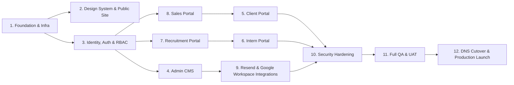

# 20 — IMPLEMENTATION ROADMAP & ENGINEERING BACKLOG

**Date:** 2026-11-27  
**Architecture Model:** **All 5 Portals + Public Site** architected in Initial Scope, executed across **12 structured engineering workstreams** with clear dependencies, priorities, and release gates.

*(Architecture completion = this documentation suite passing Final Audit. Implementation completion = running software passing `19_QA_TESTING_AND_ACCEPTANCE_CRITERIA.md`.)*

---

## 1. Workstream Sequence & Release Waves

---

## 2. Detailed Workstreams & Engineering Backlog

### Workstream 1 — Foundation & Infrastructure (`P0 · Complexity: M`)
- **Dependencies:** Approved Architecture Docs (`12`, `14`, `17`).
- **Tickets:**
  - `ENG-101`: Initialize clean Next.js App Router + TypeScript + Tailwind v4 workspace in `techgroww01/official-website-working`.
  - `ENG-102`: Vectorize/extract official brand assets from `techgroww_logo.svg` (`mark.svg`, light/dark lockups, favicon/OG).
  - `ENG-103`: Configure Supabase Staging project, `.env.example`, and ordered SQL migrations (`001`–`009`).
  - `ENG-104`: Configure GitHub Actions CI (`tsc`, `eslint`, `vitest`) + Vercel Preview workflow.
- **Acceptance:** Empty app + DB schema + preview deploy green; zero secrets committed.

### Workstream 2 — Design System & Public Website (`P0 · Complexity: H`)
- **Dependencies:** `W1`, `08`, `09`.
- **Tickets:**
  - `ENG-201`: Implement dual-surface CSS token system, typography (`Outfit`, `IBM Plex Sans`, `IBM Plex Mono`), accessible `Button`, `Accordion`, `Field`, `Breadcrumbs`, `CookieNotice`.
  - `ENG-202`: Implement restrained motion system (session-once `Preloader`, `ScrollProgress`, `Reveal`, pausable `Ribbon`, `prefers-reduced-motion` bypass).
  - `ENG-203`: Build Homepage (Hero, Problem Matcher, Interactive Services Blueprint, 5-Stage Delivery Rail, Updates, FAQ, NextTwo close).
  - `ENG-204`: Build `/about`, `/services`, 6 `/services/[slug]` pages, `/work`, `/work/[slug]` (with `REFERENCE BLUEPRINT` badges), `/insights`, `/insights/[slug]`, `/careers`, `/careers/internships`, `/contact`, `/privacy`, `/terms`, `/cookies`, `/404`.
- **Acceptance:** Public site matches `09` copy rules (zero unverified claims) and passes responsive + axe checks.

### Workstream 3 — Identity, Authentication & RBAC (`P0 · Complexity: H`)
- **Dependencies:** `W1`.
- **Tickets:**
  - `ENG-301`: Implement `@supabase/ssr` auth helpers, `/login`, `/forgot-password`, `/reset-password`, `/invite`, `/auth/callback`.
  - `ENG-302`: Implement `proxy.ts` / `middleware.ts` route protection (`noindex` + auth gate for all 5 portals).
  - `ENG-303`: Implement `requirePermission(resource, action, scope)` server helper + multi-role Portal Switcher shell + `audit_logs` writer.
- **Acceptance:** Deny-by-default verified across all 18 roles; user suspension revokes access immediately.

### Workstream 4 — Admin CMS Portal (`/admin`) (`P0 · Complexity: H`)
- **Dependencies:** `W2`, `W3`.
- **Tickets:**
  - `ENG-401`: Build CMS Dashboard (real DB counts) + Pages & Section composer with draft preview & publish + ISR `revalidateTag`.
  - `ENG-402`: Build Services, Work (`is_client_approved` gate), Blog/Insights (scheduled publish), Team (`is_public` gate), Testimonials (`is_approved` gate).
  - `ENG-403`: Build Media Library (signed upload + mandatory alt text), Navigation, SEO/Redirects manager, User/Role manager, and Audit Log viewer.
- **Acceptance:** Content editor can draft/publish content without developer deploys; public site reflects edits immediately.

### Workstream 5 — Client Portal (`/client`) (`P0 · Complexity: M–H`)
- **Dependencies:** `W3`, `W8`.
- **Tickets:**
  - `ENG-501`: Build Tenant-isolated Client Overview & Project Detail (`/client/projects/[id]`) with milestone timeline.
  - `ENG-502`: Build Deliverable Sign-off (`Approve` / `Request Revision`), Private File Vault (signed URLs), Project Messages.
  - `ENG-503`: Build Support Tickets (`/client/tickets`) + Read-only Billing Documents (`/client/billing`) + Client Admin team settings.
- **Acceptance:** RLS tests prove Org A cannot view/download Org B projects or files; deliverable sign-off emails Ops PM.

### Workstream 6 — Intern Portal (`/intern`) (`P0 · Complexity: M`)
- **Dependencies:** `W3`, `W7`.
- **Tickets:**
  - `ENG-601`: Build Cohort Onboarding checklist, policy acknowledgement, and mentor assignment view.
  - `ENG-602`: Build Task Board, Submission upload + Mentor Review rubric (strictly isolated from peer interns).
  - `ENG-603`: Build feature-flagged Attendance view + Completion Certificate generator (`certificate_code` + PDF).
- **Acceptance:** Interns see only own evaluations; mentors see only assigned mentees; certificate codes verify cleanly.

### Workstream 7 — Recruitment Portal (`/recruitment`) (`P0 · Complexity: M–H`)
- **Dependencies:** `W3`.
- **Tickets:**
  - `ENG-701`: Connect public `/careers/[slug]` & `/careers/internships` to `job_postings` + hardened resume intake (`PDF`/`DOCX` magic-byte check).
  - `ENG-702`: Build Candidate Pipeline board (`applied` -> `hired`), Resume signed viewer, Interview scheduler, and confidential `recruitment_notes`/scorecards.
  - `ENG-703`: Build Offer tracking -> Intern/Staff handoff + automated 180-day DPDP retention purge cron.
- **Acceptance:** Candidate never accesses internal scorecards; Sales/Client roles cannot read resumes.

### Workstream 8 — Sales Team Portal (`/sales`) (`P0 · Complexity: M–H`)
- **Dependencies:** `W3`.
- **Tickets:**
  - `ENG-801`: Connect `/contact` form -> atomic `contact_enquiries` + `leads` creation + Turnstile + rate limit.
  - `ENG-802`: Build Lead Inbox, assignment, ownership filtering (`sales_rep` own scope), Contact/Organization CRM.
  - `ENG-803`: Build Opportunity Kanban (`discovery` -> `won`/`lost`), Activity/Follow-up timeline, Proposals, Reports, and **"Convert Won Deal -> Client Project"** transaction.
- **Acceptance:** `sales_rep` isolated to own leads; won deal creates Client Portal org & project idempotently.

### Workstream 9 — Integrations (`P0 · Complexity: M`)
- **Dependencies:** `W4`, `W7`, `W8`.
- **Tickets:**
  - `ENG-901`: Wire Resend Transactional templates + daily 100/day quota monitor + `/api/v1/webhooks/resend` HMAC suppression handler.
  - `ENG-902`: Wire Resend Audiences & `/admin/broadcasts` test/live sends + unsubscribe token flow.
  - `ENG-903`: Wire Google Workspace OAuth (`@techgroww.co.in` domain lock) + optional non-blocking Google Sheets lead mirror.
- **Acceptance:** All emails deliver cleanly with SPF/DKIM/DMARC pass; Sheets outage never blocks `/contact` DB save.

### Workstream 10 — Security Hardening (`P0 · Complexity: M`)
- **Tickets:** Security headers (`CSP`, `HSTS`), RLS negative test suite, magic-byte validation tests, secret scan (`gitleaks`), rate-limit verification.

### Workstream 11 — QA & UAT (`P0 · Complexity: M`)
- **Tickets:** Full Playwright E2E + axe-core WCAG 2.2 AA + Lighthouse CWV baseline + Mobile/Tablet real-device verification + Owner UAT sign-off.

### Workstream 12 — Production Launch & DNS Cutover (`P0 · Complexity: S`)
- **Tickets:** Provision Vercel Pro + Supabase Pro + Resend `send.techgroww.co.in` + Google Workspace verification -> Apply legal & company sign-offs (`21`) -> Cut over A/CNAME DNS (preserving Google MX) -> Update LinkedIn Website URL from Google Form to `https://techgroww.co.in/` -> Submit Search Console sitemap -> Monitor 7–14 days before retiring Hostinger PHP files.

---

## 3. Release Gates & Risk Guardrails

- **Wave A (Internal Operational Readiness):** `W1`–`W4` + `W7`–`W9` verified on Staging so Sales & HR can test lead/application workflows.
- **Wave B (Full 5-Portal Launch Candidate):** `W5` (Client) + `W6` (Intern) + `W10`–`W11` pass all automated & manual QA gates -> **Cutover (`W12`)** with all 5 portals live on day one!
- **Key Risk:** Attempting cutover before `21_PRELAUNCH_VERIFICATION_CHECKLIST.md` legal/team/company confirmations are answered — blocked explicitly by Gate `W12`.

---

## 4. Cross-References

`01 PROJECT_OVERVIEW.md`, `10_FIVE_PORTAL_PRODUCT_REQUIREMENTS.md`, `19_QA_TESTING_AND_ACCEPTANCE_CRITERIA.md`, `21_PRELAUNCH_VERIFICATION_CHECKLIST.md`.

