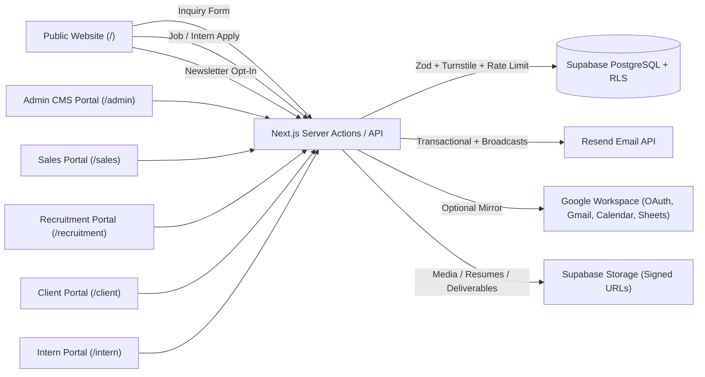

# 01 — PROJECT OVERVIEW: TECH GROWW CORPORATE DIGITAL PLATFORM

**Date:** 2026-11-27  
**Workspace:** `U:\Tech groww final sonia company`  
**Target Repository:** `https://github.com/techgroww01/official-website-working.git`  
**Legacy Live Site (Read-Only Reference):** `https://techgroww.co.in/`  
**Official LinkedIn:** `https://www.linkedin.com/company/tech-growww`  
**Official Instagram:** `https://www.instagram.com/info_techgroww.co.in/`

---

## 1. Purpose & Scope

This document defines the unified executive mandate, initial product scope (public website + **all five operational portals**), and non-negotiable engineering guardrails for **Tech Groww**. It serves as the anchor specification referenced by documents `02` through `24`.

**In Scope (Initial Architecture):**
1. **Public Corporate Website (`/`)** — Editorial, non-generic corporate experience built completely from scratch (zero legacy PHP code, templates, or unverified metrics).
2. **Five Integrated Portals (All Included in Initial Scope):**
   - **Admin CMS Portal (`/admin`)** — Full dynamic content, SEO, media, user/RBAC, Resend broadcasts, and system operations.
   - **Client Portal (`/client`)** — Organization-isolated project status, milestones, deliverables, files, communication, support tickets, and future-ready billing records.
   - **Intern Portal (`/intern`)** — Cohort/mentor-scoped onboarding, assignments, task tracking, submissions, mentor feedback, conditional attendance, certificates, and announcements.
   - **Recruitment Portal (`/recruitment` + public `/careers`)** — Job publishing, candidate application & resume uploads, ATS pipeline, interview scheduling, scorecards, offers, and DPDP data retention/deletion.
   - **Sales Team Portal (`/sales`)** — Lead capture & assignment, qualification, contact/org CRM, pipeline stages, opportunities, follow-ups, proposals, and conversion reporting.

*Note on Staged Delivery:* All five portals are architected, modeled in PostgreSQL, governed by server-side RBAC, and routed in the initial platform specification. Execution phases (`20_IMPLEMENTATION_ROADMAP_AND_ENGINEERING_BACKLOG.md`) define release waves for engineering velocity without excluding any of the five portals from the initial product scope.

---

## 2. Dependencies

- Upstream verified inputs: `COMPANY_RESEARCH_AND_AUDIT.md` (Doc 02), `COMPANY_INFORMATION_VERIFICATION.md` (Doc 03), `COMPETITOR_RESEARCH.md` (Doc 04)
- Brand & UI specifications: `BRAND_STRATEGY.md` (Doc 05), `CREATIVE_DIRECTION.md` (Doc 06), `08_DESIGN_SYSTEM_AND_UI_SPECIFICATION.md`
- Portal & technical specifications: `10_FIVE_PORTAL_PRODUCT_REQUIREMENTS.md` through `17_DEVOPS_ENVIRONMENT_AND_DEPLOYMENT_BLUEPRINT.md`

---

## 3. Five Primary Business Objectives

| # | Objective | How the Platform Delivers It |
|---|---|---|
| 1 | **Establish Memorable Corporate Identity** | Anchored to official logo (`techgroww_logo.svg`) and tagline (*"Technology That Drives Growth"*), executed with restrained architectural typography and purposeful interaction inspired by *Super 8 Studio*, *1Centre*, *Viewz*, *Jamie Windell*, and *Kiki Bhaur*. |
| 2 | **Clarify Services & Technical Depth** | Interactive capability blueprints and problem-first service architecture matching Tech Groww's `V-PUB` capabilities (Web & Mobile Engineering, Salesforce/OmniStudio, UI/UX, Enterprise Software, IT Consulting) plus `S-POST`-supported SEO & Digital Visibility (`C-06` confirmation tracked in `21`). |
| 3 | **Generate Qualified Business Leads** | Frictionless inquiry flows, service pre-selection, budget bracketing, Cloudflare Turnstile/honeypot protection, Resend notifications, and automatic handoff into the Sales Team Portal. |
| 4 | **Build Authentic Trust** | Honest early-stage narrative (founded 2026 in Greater Noida), verified leadership/team visibility (pending sign-off), transparent 5-step delivery workflow, and explicit separation of approved client engagements vs Reference Blueprints on `/work`. |
| 5 | **Unify Company Operations Across 5 Portals** | Shared PostgreSQL + Supabase Auth + RLS + deny-by-default server RBAC powering CMS, Sales, Recruitment, Client Delivery, and Internships on one modular codebase. |

---

## 4. Target Audiences & Portal Users

| Segment | Surface | Primary Goal |
|---|---|---|
| **Startups, SMBs, Enterprises, International Clients** | Public Site (`/`) | Evaluate capabilities, review Reference Blueprints, submit scoped project inquiry |
| **Prospective Candidates & Interns** | Public `/careers` + Recruitment | Browse openings, submit resumes/applications, track status |
| **Company Leadership & Editors** | Admin CMS (`/admin`) | Manage public pages, services, blog, team, media, SEO, broadcasts, and RBAC |
| **Sales Representatives & Managers** | Sales Portal (`/sales`) | Qualify inquiries, manage pipeline/opportunities, log follow-ups, record proposals |
| **Recruiters & Hiring Managers** | Recruitment Portal (`/recruitment`) | Publish openings, screen resumes, schedule interviews, manage offers |
| **Onboarded Clients** | Client Portal (`/client`) | Monitor milestones, approve deliverables, exchange files, open support tickets |
| **Interns & Mentors** | Intern Portal (`/intern`) | Track onboarding, complete assignments, submit tasks, receive reviews & certificates |

---

## 5. High-Level Platform Architecture

---

## 6. Key Decisions & Assumptions

- **Decisions:**
  - **D-01:** Greenfield build in Next.js App Router + TypeScript + Tailwind CSS + Supabase PostgreSQL + Vercel + Resend + Google Workspace (`14_TECH_STACK_AND_HOSTING_DECISION.md`).
  - **D-02:** All 5 portals included in initial platform architecture and database schema (`10_FIVE_PORTAL_PRODUCT_REQUIREMENTS.md`).
  - **D-03:** Zero reuse of legacy Hostinger PHP code, CSS, or unverified metrics/locations.
- **Assumptions:**
  - Staging runs on Vercel Pro PR Preview deployments paired with a dedicated Supabase Staging project; commercial production runs on Vercel Pro + Supabase Pro (`14_TECH_STACK_AND_HOSTING_DECISION.md`) so zero commercial activity ever relies on Vercel Hobby.
  - Mode is `DEMO` during planning; no live external accounts or GitHub remotes are touched until explicit execution approval.

---

## 7. Outstanding Confirmations

Tracked canonically in `21_PRELAUNCH_VERIFICATION_CHECKLIST.md`:
1. Official legal entity name (`[COMPANY CONFIRMATION REQUIRED: Official legal entity name]`).
2. Confirmation of Google Workspace domain ownership and DNS registrar access (`techgroww.co.in`).
3. Confirmation of team profiles/bios, business hours, and AI/Automation service inclusion.

---

## 8. Acceptance Criteria & Cross-References

- Zero contradictions between `01`–`07` and `08`–`24` regarding 5-portal initial scope.
- Every unverified claim explicitly flagged or gated behind `[COMPANY CONFIRMATION REQUIRED: ...]`.
- **Cross-References:** `WEBSITE_SITEMAP.md` (Doc 07), `10_FIVE_PORTAL_PRODUCT_REQUIREMENTS.md`, `14_TECH_STACK_AND_HOSTING_DECISION.md`, `23_ARCHITECTURE_DECISION_RECORDS.md`.
