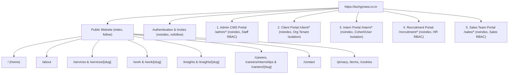

# 07 — WEBSITE & FIVE-PORTAL INFORMATION ARCHITECTURE (SITEMAP)

**Date:** 2026-11-27  
**Canonical Scope:** Public Corporate Website + **All 5 Initial-Scope Portals** (`Admin CMS`, `Client`, `Intern`, `Recruitment`, `Sales Team`).

---

## 1. Purpose & Scope

Defines the complete URL topology, route ownership, authentication boundaries, and indexing rules (`index, follow` vs `noindex, nofollow`) across the entire Tech Groww platform. Reconciles earlier Phase 2 deferrals so all five portals sit cleanly inside the initial product architecture.

**Dependencies:** `PROJECT_OVERVIEW.md` (Doc 01), `COMPANY_INFORMATION_VERIFICATION.md` (Doc 03), `10_FIVE_PORTAL_PRODUCT_REQUIREMENTS.md`, `11_RBAC_AND_AUTHORIZATION_MATRIX.md`.

---

## 2. Complete Platform Sitemap

---

## 3. Public Routes & Indexing Policy

| Route | Title / Role | Index Policy | Source of Truth |
|---|---|---|---|
| `/` | Homepage (Editorial + Interactive Blueprints) | `index, follow` | CMS + Verified Config |
| `/about` | About Tech Groww (Story, Principles, Verified Team) | `index, follow` | CMS |
| `/services` | Services Directory & Problem-First Selector | `index, follow` | CMS |
| `/services/[slug]` | 6 Core Service Detail Pages | `index, follow` | CMS |
| `/work` | Work & Reference Blueprints (Strictly Labeled) | `index, follow` | CMS |
| `/work/[slug]` | Project / Reference Blueprint Detail | `index, follow` | CMS |
| `/insights` | Insights, Technical Guides & Updates | `index, follow` | CMS |
| `/insights/[slug]` | Article Detail with Author & Reading TOC | `index, follow` | CMS |
| `/careers` | Open Positions & Culture | `index, follow` | Recruitment DB (`job_postings`) |
| `/careers/internships` | Structured Internship Program & Apply | `index, follow` | Internships (`internship_programs`) + Recruitment (`job_postings`) |
| `/careers/[slug]` | Role Detail + Secure Resume Application | `index, follow` | Recruitment DB (`job_postings`) |
| `/contact` | Project Inquiry Form & Verified Channels | `index, follow` | Verified Config -> Sales Leads |
| `/privacy`, `/terms`, `/cookies` | Legal & Data Governance Pages | `index, follow` | CMS (Counsel Review Required) |

---

## 4. Authenticated & Portal Routes (All Initial Scope — `noindex, nofollow`)

All portal routes require server-side session verification in Next.js Middleware/Proxy + Server Component/API RBAC guards, and are disallowed in `robots.txt`.

### 4.1 Authentication, Invites & Candidate Status
- `/login` — Email/password + Google Workspace OAuth (`@techgroww.co.in` staff)
- `/forgot-password` & `/reset-password` — Tokenized password recovery
- `/invite` — Tokenized invite acceptance for Staff, Clients, and Interns
- `/auth/callback` — OAuth/PKCE verification & domain/pre-invite enforcement
- `/careers/status` — Tokenized unauthenticated Candidate status lookup, interview schedule view & offer accept/decline (`noindex, nofollow`)

### 4.2 Portal 1 — Admin CMS Portal (`/admin`)
- `/admin` — Executive overview (real DB aggregates only)
- `/admin/pages` — Page & section composer, draft preview, publish workflow
- `/admin/services` — Service catalog, capabilities, tech tags, FAQs, SEO
- `/admin/work` — Client projects vs Reference Blueprints (`project_type` enforced)
- `/admin/insights` — Articles, categories, tags, authors, scheduled publish
- `/admin/team` & `/admin/testimonials` — Profiles & approval-gated quotes
- `/admin/media` — Media library, alt text, metadata, CDN optimization
- `/admin/navigation` — Header/footer link management
- `/admin/seo` — Meta titles, canonicals, OG tags, sitemap inspection, 301 redirects
- `/admin/broadcasts` — Resend Audience segments, drafts, test sends, campaign history
- `/admin/users` — User directory, role assignments, suspensions
- `/admin/audit` — Immutable append-only platform audit log viewer (`auditor`, `admin`, `super_admin`)
- `/admin/settings` — Global settings, notification rules, integration health

### 4.3 Portal 2 — Client Portal (`/client`)
- `/client` — Active engagements overview (tenant-scoped to `client_org_id`)
- `/client/projects/[id]` — Milestones, deliverables, approval actions, status timeline
- `/client/files` — Shared documents & signed downloads
- `/client/messages` — Threaded project communication
- `/client/tickets` — Support request creation & SLA status
- `/client/billing` — Billing documents & invoice records (placeholder/record view until payment gateway phase)
- `/client/settings` — Client team management (`client_admin` only) & notifications

### 4.4 Portal 3 — Intern Portal (`/intern`)
- `/intern` — Cohort overview, mentor contact, active assignments
- `/intern/onboarding` — Onboarding checklist & policy acknowledgements
- `/intern/tasks` — Assigned tasks, deadlines, status board
- `/intern/submissions` — Deliverable uploads & mentor feedback
- `/intern/attendance` — Attendance / check-in log (gated by formal program approval)
- `/intern/certificates` — Earned completion certificates & verification ID
- `/intern/announcements` — Cohort & company notices

### 4.5 Portal 4 — Recruitment Portal (`/recruitment`)
- `/recruitment` — Hiring funnel overview
- `/recruitment/jobs` — Job & internship requisitions (draft/open/closed)
- `/recruitment/candidates` — Candidate pipeline board & filterable list
- `/recruitment/applications/[id]` — Resume preview/download, stage transitions, interview schedule, private scorecards/notes
- `/recruitment/offers` — Offer tracking & status
- `/recruitment/retention` — Candidate data deletion & DPDP retention queue

### 4.6 Portal 5 — Sales Team Portal (`/sales`)
- `/sales` — Pipeline KPIs, assigned follow-ups, daily focus
- `/sales/leads` — Inbound website enquiries (`contact_enquiries` -> `leads`), assignment & qualification
- `/sales/contacts` & `/sales/organizations` — Account & contact directory
- `/sales/opportunities` — Kanban/list pipeline stages (`discovery` -> `scoping` -> `proposal_sent` -> `negotiation` -> `won` | `lost`)
- `/sales/proposals` — Proposal records, PDF attachments, scope notes
- `/sales/activities` — Call logs, meeting notes, follow-up reminders
- `/sales/reports` — Conversion rates, source attribution, rep performance (scoped)

---

## 5. Service Taxonomy & Legacy Redirect Map

### 5.1 Published Launch Service Slugs (6 Core Services)
1. `/services/web-mobile-engineering`
2. `/services/salesforce-solutions`
3. `/services/ui-ux-design`
4. `/services/enterprise-software`
5. `/services/it-consulting`
6. `/services/digital-marketing-seo`

*(AI & Business Process Automation remain configurable as `draft` records in `/admin/services` until confirmed for public release.)*

### 5.2 Mandatory 301 Redirects (Old `techgroww.co.in` URLs)
- `/about.php` -> `/about`
- `/services.php` -> `/services`
- `/services/web-development` -> `/services/web-mobile-engineering`
- `/services/software-development` -> `/services/enterprise-software`
- `/services/digital-marketing` -> `/services/digital-marketing-seo`
- `/services/automation` -> `/services/enterprise-software`
- `/services/ai-solutions` -> `/services/it-consulting` *(deterministic launch target; to publish `/services/ai-solutions` later if AI practice is confirmed, **deactivate** [`is_active = false`] this redirect rule in `/admin/seo` rather than setting self-referencing destination)*
- `/portfolio` -> `/work`
- `/portfolio.php` -> `/work`
- `/contact.php` -> `/contact`
- `/privacy-policy` -> `/privacy`
- `/admin/login.php` -> `410 Gone` *(recommended security posture to deter legacy brute-force bots — `proxy.ts` **must** evaluate the `redirects` rule set before `/admin/*` auth redirection so `/admin/login.php` cleanly returns `410` without leaking `/login`)*; **never** linked in public footer.

---

## 6. Decisions, Assumptions & Acceptance Criteria

- **Decision:** Unify `/admin`, `/sales`, `/recruitment`, `/client`, and `/intern` under one Next.js deployment with strict middleware + RLS route isolation rather than 5 separate codebases.
- **Assumption:** Internal staff holding multiple roles (e.g., Founder who oversees CMS + Sales + HR) see a clean top-bar Portal Switcher showing only portals granted by their RBAC roles.
- **Acceptance Criteria:** Every route has an explicit owner, auth guard, SEO indexing directive, and zero orphaned links; legacy URLs redirect via `301` cleanly.
- **Cross-References:** `09_PUBLIC_WEBSITE_CONTENT_AND_PAGE_SPECIFICATIONS.md`, `10_FIVE_PORTAL_PRODUCT_REQUIREMENTS.md`, `11_RBAC_AND_AUTHORIZATION_MATRIX.md`.
